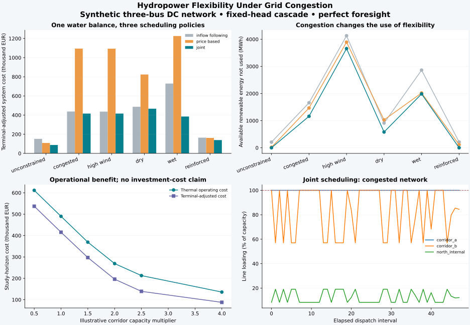

# Hydro Cascade Lab

**An auditable hydropower modelling project: conserve water, schedule generation, evaluate uncertainty.**

[](https://github.com/Logasubramaniyan/hydro-cascade-simulator/actions/workflows/ci.yml)
[](pyproject.toml)
[](LICENSE)

Reservoir hydro creates a useful modelling challenge: water can generate at several plants, takes time
to travel downstream, and has an opportunity value when saved for later. This project makes those
physical and economic assumptions explicit and tests them against analytical examples.


## What you can explore

- **Physical simulation:** bounded storage, turbine limits, environmental shortfalls, spill and bypass,
  branching river links, integer travel delays, water in transit, optional losses and release ramps.
- **Producer scheduling:** sparse linear optimization with HiGHS; supplied positive or negative prices;
  terminal storage targets/value; independent replay of every optimized release.
- **Uncertain decisions:** a finite scenario tree with shared decisions and validated histories;
  rolling deterministic/stochastic forecasts evaluated on held-out synthetic paths.
- **Small power markets:** hydro/thermal/renewable dispatch, congested zonal interconnectors, marginal
  prices, local upward reserve, continuous thermal investment and illustrative outage trials.
- **Evidence:** analytical solutions, randomized conservation tests, USGS unit/quality handling,
  observation scoring, input hashes and environment/solver manifests.

The implemented models are research/portfolio tools. The examples are synthetic unless explicitly
labelled measured. Real-plant calibration, operational bidding and parity with commercial software have
not been established. Read the [model specification](docs/MODEL.md) before interpreting results.

## Hydropower flexibility under grid congestion

An optional [PowerGAMA](https://github.com/powergama/powergama) backend connects the physical cascade
to a meshed DC power network. Compare an inflow-following schedule, an independently price-optimized
schedule assessed against network limits, and joint water/electricity optimization. The cascade owns
the water balance; mapped PowerGAMA generators have no second energy-storage model.



The [48-hour case study](docs/GRID_CASE_STUDY.md) includes six scenarios, corridor reinforcement
sensitivity, signed nodal prices, line loading, renewable curtailment and independent physical audits.
Inputs are explicitly synthetic; the earlier public USGS sample remains a separate measured-data example.

Use a separate Python 3.11-3.12 environment for the optional backend, whose dependencies differ from
the lightweight core snapshot. Activate that environment before running:

```bash
python -m pip install -c constraints-powergama.txt -e ".[dev,powergama]"
hydro-grid --output runs/grid-study --steps 48 --seed 42
python -m pytest tests/test_powergama.py tests/test_grid_inputs.py -q \
  --cov=hydrocascade/powergama --cov-config=.coveragerc-powergama
python tools/check_grid_evidence.py
```

Read the [integration specification](docs/POWERGAMA.md) for the exact upstream commit, units,
terminal accounting, Python API and limitations. The exported CSV prices preserve signed duals;
the pinned upstream SQLite price extractor applies an absolute value. Attribution is in
[third-party notices](THIRD_PARTY_NOTICES.md).

## Run the complete offline case study

Requires Python 3.10-3.12. No API key or commercial solver is needed for the demonstration.

```bash
git clone https://github.com/Logasubramaniyan/hydro-cascade-simulator.git
cd hydro-cascade-simulator
python -m venv .venv
# Linux/macOS: source .venv/bin/activate
# Windows PowerShell: .\.venv\Scripts\Activate.ps1
python -m pip install -c constraints-tested.txt -e ".[dev]"
python -m hydrocascade demo --output runs/demo --seed 42 --trials 8 --steps 48 --horizon 12
python -m pytest -q -m "not powergama" --cov=hydrocascade --cov-config=.coveragerc-core
```

Open `runs/demo/dispatch.svg` and `runs/demo/policies.svg`. Inspect `results.json`, individual schedules,
policy-trial CSVs, market outputs and `manifest.json`. The [case study](docs/CASE_STUDY.md) explains the
checked-in results; the [validation guide](docs/VALIDATION.md) distinguishes numerical evidence from
operational validation. `constraints-tested.txt` is a tested direct-dependency snapshot, not a full lock.

## A small known-answer optimization

```python
from hydrocascade import Cascade, Plant, optimize

plant = Plant(
    "p",
    "One-MW example",
    storage_capacity_m3=3600,
    initial_storage_m3=3600,
    max_flow_m3s=1,
    head_m=1e6 / (1000 * 9.81 * 0.9),
)
result = optimize(Cascade((plant,)), [[0], [0]], [10, 100], terminal_min={"p": 0})
print(result.records[["step", "power_mw", "storage_m3"]])
print(result.revenue_eur)  # EUR 100: generate the available 1 MWh in hour two.
```

Default scheduling preserves each plant's configured initial storage at the horizon. The example
explicitly relaxes that target; it is not an implied recommendation to empty an operating reservoir.

## Bring your own cascade

`examples/cascade.json` contains plant definitions and river links. `examples/hourly.csv` has UTC ISO
timestamps, EUR/MWh prices and one local `inflow_<plant_id>_m3s` column per plant. Missing intervals,
duplicate timestamps, ambiguous date formats and invalid values are rejected.

```bash
hydro-cascade schedule --config examples/cascade.json --inputs examples/hourly.csv \
  --dt-seconds 3600 --output runs/custom
```

In Python, use `Scenario` and `stochastic_schedule` for explicit scenario trees, `rolling_policy` for
the illustrative forecast experiment, and `clear_market` for a small coupled system. See the executable
[walkthrough](examples/walkthrough.py) and [architecture notes](docs/ARCHITECTURE.md).

## Public measured river-flow data

```bash
hydro-cascade fetch-usgs --site 06090800 --start 2023-01-01 --end 2023-01-15 \
  --output runs/usgs.csv
```

The adapter uses the modern USGS v1 API, converts ft³/s to m³/s, retains quality flags, checks daily
coverage and saves the raw response plus provenance. The [checked-in sample](data/observed/README.md)
makes this evidence available offline. A `USGS_API_KEY` environment variable may be used for higher
request limits; it is never written to provenance. Gauge discharge can include upstream regulation and
must not automatically be interpreted as a reservoir's natural inflow.

## What this demonstrates technically

The project separates physical state evolution, sparse optimization and experimental evaluation.
Every solved hydro schedule is independently replayed, including delayed spill water. Shared scenario
nodes prevent decisions from using future outcomes. A perfect-foresight benchmark makes the information
advantage visible, and common terminal accounting keeps policy comparisons interpretable.

The repository includes a package/CLI, CI on Linux and Windows, numerical and integration tests,
recorded benchmark evidence, an explicit specification and a [scoped development roadmap](docs/ROADMAP.md).

## Sources and further development

- [SciPy / HiGHS linear programming](https://docs.scipy.org/doc/scipy/reference/generated/scipy.optimize.linprog.html)
- [USGS modern water-data API](https://api.waterdata.usgs.gov/docs/ogcapi/migration/)
- [SDDP.jl hydro-valley example](https://sddp.dev/stable/examples/hydro_valley/)
- [AFRY BID3 published functionality](https://bid3.afry.com/publicpages/key-functionality.html)
- [Svenska kraftnät-hosted hydropower/BID3 thesis](https://www.svk.se/siteassets/5.jobba-har/dokument-exjobb/implementation-of-hydropower-modeling-for-electricity-market-simulations-using-bid3.pdf)

These sources inform the formulation and comparison. This project contains no BID3 code or calibrated
AFRY dataset. Code is [MIT licensed](LICENSE); USGS observations retain source attribution.
