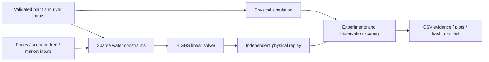

# Architecture and design decisions

## Responsibilities

| Module | Responsibility |
|---|---|
| `model.py` | Immutable plant/link definitions, SI units, topology validation |
| `simulation.py` | State transitions, transit queues, sink/loss accounting, replay |
| `lp.py` | Sparse matrix assembly, solver status and residual checks |
| `scheduling.py` | Water constraints, deterministic/scenario-tree producer objective |
| `market.py` | Zonal balance, costs, reserves, optional investment and outage sampling |
| `experiments.py` | Training/evaluation split, synthetic generation, rolling decisions, sensitivity |
| `data.py` | Strict file IO, public USGS ingestion and provenance |
| `validation.py` | Independent-observation alignment, coverage and error metrics |
| `reporting.py` | Figures, dependency/input/code/output hashes |
| `cli.py` | Reproducible end-to-end workflows |
| `powergama/network.py` | Optional DC network schema, mappings and validation |
| `powergama/backend.py` | Water-block extension, native PowerGAMA solve and independent audits |
| `powergama/study.py` | Six synthetic congestion cases, sensitivity and hashed evidence |

## Why a linear fixed-head baseline?

It supports independently understandable constraints and optimality certificates at modest runtime.
The solver is bundled through SciPy, so the example needs no commercial license. Variable head and
unit commitment should be introduced only with data and verification cases sufficient to justify them.
The sparse builder is shared between models, while the simulator does not depend on its matrix logic.

## Why explicit terminal conditions?

A finite-horizon model can overvalue using water before its artificial endpoint. Default producer
scheduling protects configured initial storage. Experiments relax that target but value remaining
reservoir/transit water consistently for all policies. Fixed values remain an approximation; a fitted
seasonal policy/value function is a separate research stage.

## Why a scenario tree rather than a claimed SDDP implementation?

The finite tree makes shared-information decisions explicit and testable. It is adequate for small
experiments but grows with scenarios and horizon. The rolling three-regime forecast is intentionally
simple and optimistic about future regime revelation. SDDP with appropriate state and uncertainty
models is a future extension for long-horizon seasonal problems, not a label for independent scenarios.

## Why keep a separate physical replay?

An optimizer can solve the wrong equations perfectly. Replay checks controls, per-plant storage and
global storage-plus-transit conservation with independent logic. Analytical tests and observations
remain necessary: agreement between two implementations alone does not prove realism.

## Reproducibility boundaries

The optional grid backend inserts the existing `water_block` constraints into PowerGAMA's Pyomo
extension interface. Native hydro storage and pumping are disabled, so there is one physical water
state. PowerGAMA owns electrical balance, meshed DC flows and thermal/renewable dispatch. Hydro
generation is tied to turbine discharge using the fixed-head conversion coefficient. Independent
replay owns the physical validation; separate nodal/DC/objective audits check the native solution.
Full-window optimization is supported; rolling windows and resume are rejected until reservoir and
transit-state transfer are implemented. See [POWERGAMA.md](POWERGAMA.md).

The CLI exports seeds, assumptions, exact input files, software versions and SHA-256 hashes. CI
exercises tested versions across operating systems plus a latest-dependency job. The dependency
snapshot pins direct dependencies; it is not a fully hashed supply-chain lock. Plot timestamps are
removed, while run manifests retain their real creation time. Degenerate LP solutions may differ
without changing economic objective or feasibility.
