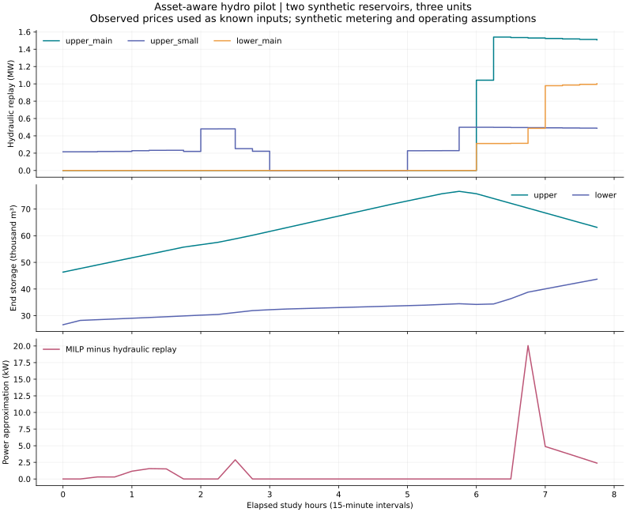

# Asset-aware pilot: units, changing head and measured-outcome interfaces

The case asks whether an economically attractive continuous water schedule survives more detailed
turbine modelling, and how a company could evaluate it against independently supplied observations.
The [complete evidence](pilot-evidence/) includes exact inputs, outputs and source fingerprints.

**Boundary:** two invented reservoirs and three invented turbine units, synthetic inflows, maintenance,
metering and settlement assumptions. Only the day-ahead prices are observed public SE4 values. They
are supplied as known future inputs for this engineering benchmark, not as a forecast available at
the declared issue timestamp. This is neither a historical company result nor an achieved saving.



## Operating case

The window is eight hours from 27 October 2026 00:00 UTC, with 32 quarter-hours. The upper reservoir
has 90,000 m3 capacity and initially 45,000 m3; the lower has 50,000 and initially 25,000 m3. Their
minimum storages are 5,000/3,000 m3. Water takes 30 minutes to travel downstream; the initial transit
queue is explicit. Local inflows are 2/0.2 m3/s, both minimum releases are 0.4 m3/s, release ramps are
8 (m3/s)/hour, and terminal targets preserve initial reservoir volumes.

Forebay level changes with stored volume. Fixed tailwater, supplied unit efficiency/flow curves
and an upper-main quadratic loss coefficient determine power. The upper plant has 1–3 and 0.5–1
m3/s units; the lower has a 1–4 m3/s unit. Minimum run/rest times, startup/running costs, flow ramps
and an upper-small-unit outage are explicit. A triangulated MILP chooses unit states and flow;
independent replay calculates hydraulic power along each interval's changing-storage path.

## Published findings

| Quantity | Result | Interpretation |
|---|---:|---|
| Interpolated-model energy revenue | EUR 392.28 | Known-input synthetic engineering case |
| Terminal-adjusted objective | EUR 1,419.64 | Includes supplied value of water left in reservoirs/transit; subtracts unit and release-variation costs |
| Financial evaluation net cash | EUR 387.69 | Synthetic meters and assumed imbalance/penalty prices; excludes unspecified asset costs and terminal water |
| Maximum mean-power approximation error | 0.020058 MW | Below the supplied 0.03 MW screen, about 20.06 kW |
| Maximum water residual | below 2e-11 m3 | Numerical accounting check, not measured reservoir accuracy |
| Synthetic training efficiency multiplier | 0.92 | Known-factor recovery on 16 training intervals |
| Later efficiency-fit MAE | 0.053416 MW | Eight held-out intervals deliberately use a changed multiplier of 0.88 |

The hydraulic screen passes and independently calculated instantaneous export stays within the
3 MW connection. The configured illustrative 0.1 MW energy-quantity increment screen **fails**.
The model does not round the schedule and pretend its water trajectory remains valid.

Synthetic observation perturbations and one missing storage value also cause observation thresholds
to **fail**: both storage MAEs exceed the supplied 5 m3 threshold, and upper power exceeds its 0.005 MW
threshold. These are deliberate interface/acceptance examples, not measurements of a real plant's
performance. All command decision reports remain `research_only`.

The fit reproduces the known training multiplier but still has a later error after the synthetic
efficiency change. This illustrates why fitted parameters require independent held-out validation;
a nearly exact training fit is not sufficient. Geometry, discharge, tailwater and losses were given,
so this single multiplier does not identify a full physical asset model.

The recorded MILP has 6,240 variables and 1,632 binary variables. Solver time, node count, gap and bound
are in [the audit](pilot-evidence/plan/audit.json); this is a batch experiment with no real-time or
large-system performance claim. Different optimality-tolerance incumbents can have slightly different
flows/cashflows; compare physical and objective tolerances rather than byte-identical reruns.

## Review regressions

The independent review found a case where interval-average power was about 0.429 MW and a 0.45 MW
connection appeared acceptable, while instantaneous power reached about 0.540 MW. The peak audit now
checks all endpoints and crossed level knots on the common interval path and marks the case `hold`.
Other regressions reject mistyped river-link fields, off-grid timestamps and incorrectly anchored
blocks. Small tests compare unit commitment against exhaustive binary schedules and test inherited
obligations, forced outages, negative prices, release limits and delayed downstream water.

## Reproduce or bring company data

```bash
hydro-pilot plan --config examples/asset_case.json --output runs/asset-plan
hydro-pilot verify --directory runs/asset-plan
python tools/build_pilot_evidence.py --output runs/pilot-reproduction
python tools/check_pilot_evidence.py
```

The full builder also runs historical cashflow/observation evaluation and chronological efficiency
fitting. To rerun those commands directly, use `docs/pilot-evidence/evaluation_case.json` and
`docs/pilot-evidence/calibration_case.json`; their CSV paths resolve relative to the configurations.
Use fresh output directories. No API key, market account or commercial solver is required.

The [input/model specification](PILOT_MODEL.md) explains units, exact settlement convention and
handoff. Projected state is explicitly labelled and must not be mistaken for measured execution.
A company should replace the synthetic inputs, verify permits and market rules, agree error and
coverage thresholds, and compare against its incumbent on held-out periods. Dynamic tailwater,
prohibited operating zones, seasonal/stochastic commitment, real-network security, telemetry and
order submission remain further work. The earlier stochastic reserve and native grid models are
separate workflows with their own approximations.
