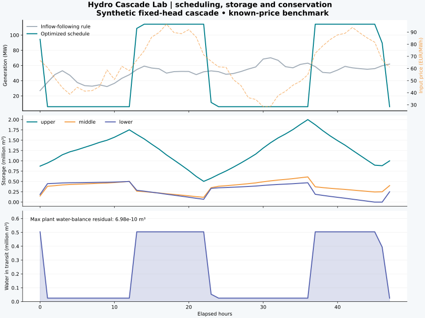
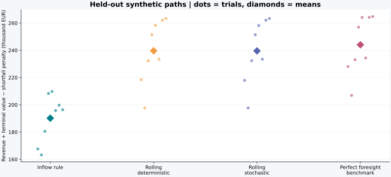

# Scheduling a three-reservoir cascade under uncertain prices and inflows

## Decision and experimental boundary

When should a producer release water through an upstream-to-downstream cascade, and how much value
is lost when future inflows/prices are unknown? This case uses three invented fixed-head reservoirs,
one-hour downstream travel delays, hourly prices and explicit environmental releases. It is an
engineering experiment with synthetic data, not a forecast for a named plant or market.

The complete record is in [`evidence/`](evidence/). Run:

```bash
python -m hydrocascade demo --output runs/demo --seed 42 --trials 8 --steps 48 --horizon 12
```

## Physical experiment

The reservoirs have heads of 90/55/35 m and turbine capacities of 65/75/85 m³/s. Storage capacities are
2.0/0.8/0.5 million m³, initially 50% full. Minimum total releases are 3/4/5 m³/s. Initial transit is
empty. Efficiencies are 90%, with fixed head and no losses or unit-commitment constraints.



The known-future schedule shifts generation toward valuable hours while satisfying terminal storage
targets. On the seed-42, 48-hour path, energy revenue is **EUR 203,211.08**. The independent replay's
largest global water residual is **4.66 × 10⁻¹⁰ m³**. These figures establish behavior of this synthetic
formulation and numerical accounting; they do not establish real-plant accuracy or commercial uplift.

## Unknown-future policy comparison

Training uses 168 synthetic hours generated with seed 142. Eight independent evaluation paths use
seeds 1142-1149, each 48 hours long. The rolling horizon is 12 hours. The current inflow/price is observed
before decisions; future forecasts use current observations decaying toward training-only means.
The stochastic policy uses three future regimes with probabilities 0.25/0.50/0.25 and identical root
decisions. Regimes are assumed revealed after that root; this is a simplified recourse assumption.

All policies start with the same reservoir/transit states. The evaluation objective is energy revenue
plus remaining storage/transit value minus environmental shortfall penalties. Fixed carryover values
use generation-equivalent water at EUR 65/MWh, including downstream plants. They are illustrative,
not estimated seasonal values. Comparing revenue alone would reward unequal depletion.



| Policy | Mean revenue (EUR) | Mean evaluation objective (EUR) | Objective standard deviation (EUR) |
|---|---:|---:|---:|
| Inflow-following rule | 152,160.59 | 190,179.51 | 17,733.73 |
| Rolling deterministic | 219,657.43 | 239,630.01 | 23,447.88 |
| Rolling stochastic | 220,229.56 | 239,568.06 | 23,498.51 |
| Perfect-foresight benchmark | 223,699.86 | 244,063.05 | 21,546.44 |

The standard deviation is variation across eight synthetic trials, not a confidence interval for a
real-world financial forecast. Both rolling policies improve on the simple rule for these inputs.
The stochastic policy's mean objective is **EUR 61.95 lower** than the deterministic policy's.
Higher revenue alone therefore does not imply a better terminal-adjusted result. This experiment does
not demonstrate that scenario optimization universally improves decisions. Forecast quality,
scenario construction and carryover assumptions need further investigation.

The perfect-foresight schedule has an information advantage and is an upper benchmark, not an
implementable policy. The largest global residual across all policies/trials is below 1.4 × 10⁻⁹ m³.
Per-trial values and terminal states are in [`policy_trials.csv`](evidence/policy_trials.csv).

## Small coupled-market experiment

The same cascade is coupled to north/south zones, gas capacity, synthetic demand and renewable
profiles. A 20 MW interconnector limits trade; each zone requires 8 MW of upward reserve. Energy
and reserve share thermal/turbine capacity, with a hydro activation-energy storage safeguard.

The illustrated dispatch serves all demand in the base case. A north thermal capacity addition is
available at an explicitly horizon-specific cost; the optimizer chooses **0 MW** for these assumptions.
This is evidence of an endogenous continuous build decision, not an annual expansion forecast.
All zonal prices, thermal dispatch and interconnector flows are exported for inspection.

Twenty seeded independent-outage trials yield mean unserved energy of **127.77 MWh** and mean
loss-of-load duration of **3.15 hours within the 48-hour horizon**. These are synthetic, perfect-foresight
dispatch trials with interval-independent outages. They are not calibrated annual LOLE or a reliability
compliance result. See [`adequacy_trials.csv`](evidence/adequacy_trials.csv).

## Public data and next validation step

The USGS sample is real river discharge with original units and quality flags. The executable
`examples/public_flow_forcing.py` applies it to an invented reservoir solely to check ingestion and
physical accounting. No reservoir storage or generation observations are claimed.

To make a real-cascade claim, collect independently observed storage, generation and discharge;
document operating restrictions and inflow interpretation; fit parameters only on a calibration period;
evaluate held-out wet/dry periods and compare with a simple baseline. The provided observation scorer
reports coverage and errors, but it does not manufacture observations or a calibration result.

The modelling decisions, information assumptions and remaining limitations are documented in
[MODEL.md](MODEL.md), [VALIDATION.md](VALIDATION.md) and [ROADMAP.md](ROADMAP.md).
