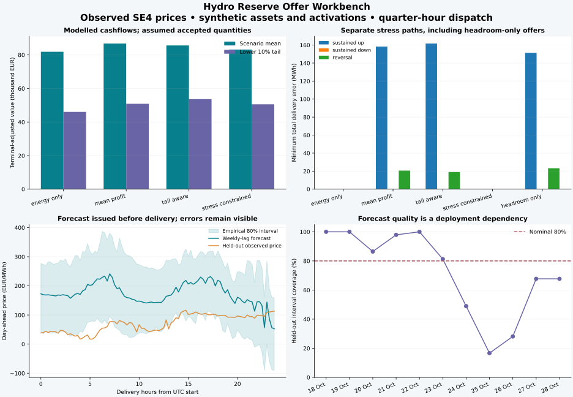

# Hydro Reserve Offer Workbench: a company assessment case

The experiment addresses a concrete planning question: how much confidence should a company place
in a financially attractive hydro reserve offer when activation, river constraints, forecast error
and network conditions are considered separately? It uses an observed-price archive and explicitly
synthetic assets. It is an engineering benchmark, not a company's historical operating result.



## Inputs and information available

The [observed SE4 archive](../data/market/README.md) contains 3,744 quarter-hours, including ten
negative prices, from 20 September to 28 October 2026 UTC. The exact API response, CC BY 4.0 licence,
original-provider attribution and raw/CSV hashes are retained. The study plans 96 quarter-hours
starting **27 October 2026 00:00 UTC**, with a forecast issued **26 October 10:00 UTC**. This is a
UTC study window; executable local auction-day objects and bid rules are separate integration work.

The weekly UTC-lag baseline and empirical daily-residual scenarios use only intervals ending by
that issue. Three representative price paths are crossed with two synthetic inflow regimes and
three activation patterns, giving **18 positive-probability financial paths**. The stress-constrained
policy adds **18 zero-probability security paths** spanning sustained up/down activation and repeated
reversals. Observable histories determine which recourse actions must remain shared.

The synthetic cascade has 20/15/10 MW plants, storage capacities of 80,000/45,000/18,000 m3, initial
storage 35,000/15,000/9,000 m3 and river delays of 30/15 minutes. Initial turbine flow, total release
and nonempty transit queues are explicit. Fixed-head conversion is exactly one MW per m3/s, an
analytical simplification. Turbine availability is derated during maintenance; the connection limit
temporarily decreases from 36 to 24 MW. Minimum release is 2 m3/s at each plant, with hard total-release
ramps and time-dependent storage maxima.

Reserve quantity caps are 8 MW in each direction. Assumed accepted capacity prices are 18 EUR/MW/h
up and 12 down; assumed activation prices are 120 EUR/MWh up and 35 down. These are **synthetic
financial assumptions**, not observed mFRR prices. All strategies share terminal targets at 80% of
configured initial storage and generation-equivalent 65 EUR/MWh carryover values, including transit.
The exact arrays and state are in [case.json](operations-evidence/case.json).

## Financial comparison

The [summary](operations-evidence/summary.csv) reports conditional model value: day-ahead plus
capacity/activation cashflows, terminal water value and the release-variation cost proxy. The tail
is the probability-weighted lower 10% of that value. Forecast scenario weights are illustrative;
no observed company profit, calibrated return distribution or achieved uplift is claimed.

| Policy | Expected adjusted value, EUR | Lower-tail adjusted value, EUR | Mean up reserve, MW | Mean down reserve, MW |
|---|---:|---:|---:|---:|
| Energy only | 81,871.36 | 46,047.65 | 0.00 | 0.00 |
| Mean profit | 86,786.36 | 50,893.26 | 6.60 | 7.83 |
| Tail aware | 85,659.38 | 53,669.80 | 6.76 | 7.71 |
| Stress constrained | 83,218.94 | 50,576.28 | 0.00 | 7.71 |

The tail-aware objective uses 45% mean and 55% lower-tail value. It improves the represented
distribution's downside at some expected-value cost. The mean-profit solution bounds the expected
value on their common feasible set; the tail-aware solution bounds the mean/CVaR utility of that
incumbent. Those invariants are checked automatically. Risk preference and security constraints
answer different questions, as the separate delivery tests show.

## Activation delivery

The [stress assessment](operations-evidence/stress_assessment.csv) fixes each offer and minimizes
absolute delivery error over an independent physical trajectory. Water, environmental, outage,
connection and terminal constraints remain hard. The headroom-only comparator takes the energy-only
schedule and fills the apparent spare connection/installed MW with reserve, without checking its
activation-water trajectory. It is a diagnostic comparator, with no achieved-profit claim.

Minimum total delivery error in MWh, rounded to two decimals:

| Policy | Sustained up | Sustained down | Reversals |
|---|---:|---:|---:|
| Energy only | 0.00 | 0.00 | 0.00 |
| Mean profit | 158.35 | 0.00 | 20.59 |
| Tail aware | 161.68 | 0.00 | 18.99 |
| Stress constrained | 0.00 | 0.00 | 0.00 |
| Headroom only | 151.41 | 0.00 | 23.23 |

The sustained tests deliberately activate for the **entire 24-hour horizon**; reversals alternate
direction every hour. These are severe engineering stresses, not the durations of a specific TSO
qualification test. The stress-constrained strategy's zero upward reserve is an economic/physical
response to those assumptions; it is not a general recommendation against upward hydro reserve.
Companies can supply product-specific activation paths through the case interface.

A single stress solve is an optimistic trajectory-existence check. The joint security paths also
share controls whenever their observed histories agree, but the result still covers only the
represented paths. Neither establishes a validated feedback controller for unseen conditions.

## Forecast failure is part of the result

The eleven rolling-origin delivery-day tests, 18-28 October UTC, have mean MAE **77.81 EUR/MWh**,
empirical interval coverage **72.25%** against nominal 80%, and empirical ensemble CRPS
**56.02 EUR/MWh**. Wider empirical bands are not evidence of a calibrated probabilistic model.
See [forecast_backtest.csv](operations-evidence/forecast_backtest.csv) and the complete
[held-out predictions](operations-evidence/forecast_predictions.csv).

At the 26 October issue, only fully completed earlier score days can enter the forecast-health
decision. The latest three eligible days are 23-25 October, with **48.96% coverage** and
**103.14 EUR/MWh mean MAE**. The configured 70% recent-coverage trigger therefore gives **hold**.
Later delivery outcomes cannot improve or worsen that earlier decision retroactively.

The [held-out cashflow evaluation](operations-evidence/heldout_day_ahead_cash.csv) reprices the
unchanged first-stage energy quantities at the actual 27 October auction prices. For example, the
tail-aware plan has **76,332.90 EUR** expected day-ahead cash in its forecast scenarios, versus
**28,436.84 EUR** at the held-out auction outcome. That large forecast miss remains visible.
This comparison excludes other cashflows and is not total realized profit. It demonstrates why
optimizing CVaR against a poorly validated scenario distribution cannot establish reliable real-world
downside protection. A company should substitute and validate its forecast/scenario process.

## Electrical absorption

The optional PowerGAMA check fixes a high-output stress-constrained trajectory exactly. The intact
illustrative connection absorbs it without dumped energy. Derating the line from 40 to 10 MW leaves
**112.64 MWh** dumped in this synthetic network. Hydro controls and water are not silently changed.
The [native grid assessment](operations-evidence/grid_assessment.csv) reports this separately from
the reserve-water checks. It is not a complete N-1, market redispatch or integrated stochastic-grid
study.

## Verification, reproduction and next use

All four optimized policies deliver their represented commitments within 1e-5 MW, and maximum
independent water-conservation residual is below 8e-9 m3 in the published run. Source and exported
artifact hashes, package versions, financial/security scenario counts, forecast issue provenance,
per-policy outcomes and selected dispatch traces are committed. Native SQLite is retained in local
runs or CI artifacts. The export map states which trajectories are saved; `--all-records` saves all.

```bash
hydro-operations study --output runs/operations-reproduction --steps 96 --with-grid
python tools/check_operations_evidence.py
```

The native grid option needs the pinned optional environment. Core-only users can omit it. The
verifier checks the committed evidence; reruns may choose different degenerate controls while
preserving economic objectives and physical tolerances. Runtime is recorded per solve. The published
full-day LPs contain tens of thousands of variables and are batch experiments, without a real-time
performance claim.

The [decision report](operations-evidence/decision_report.json) remains `research_only`. Its useful
outputs for a company are the forecast-health failure, delivery-stress differences, physical audit
trail and network-absorption finding. Real-asset calibration, product rules and measured settlement
remain the next requirements in [the company pilot guide](COMPANY_PILOT.md).
